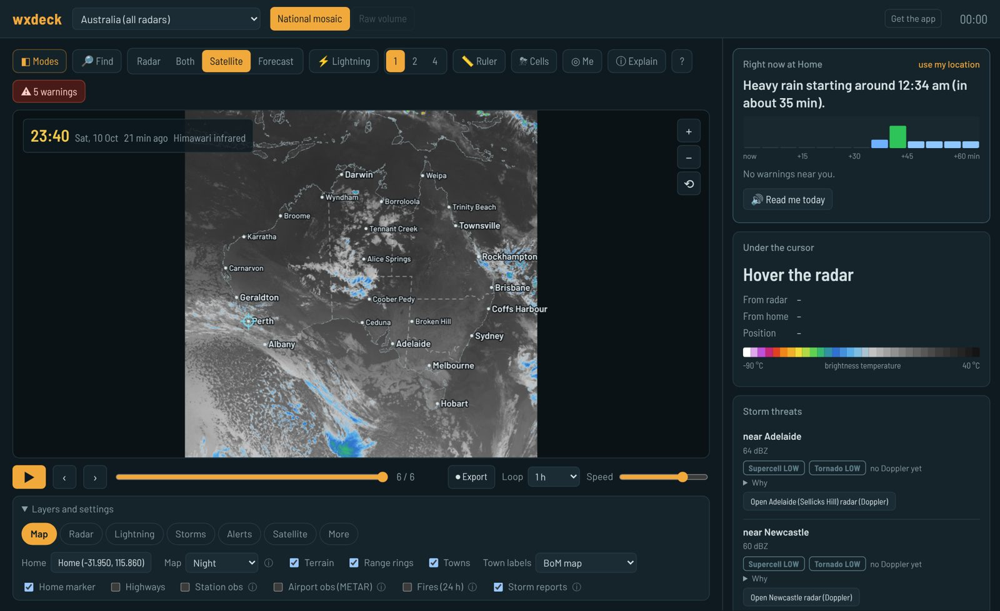
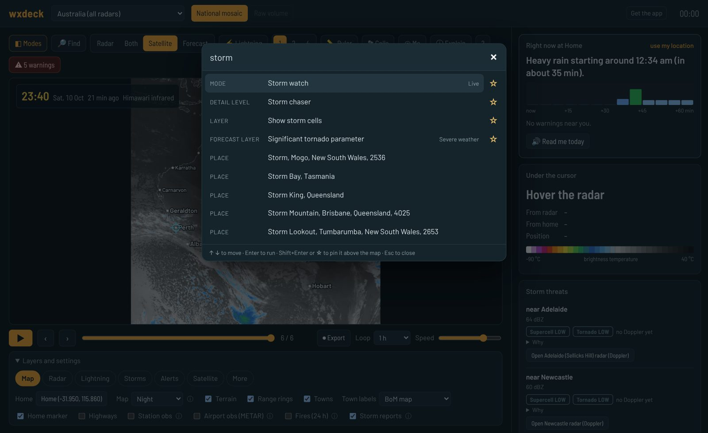
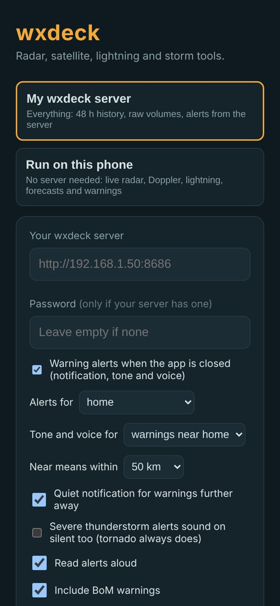

# wxdeck

**A RadarScope + Windy style weather workstation for Australia that you run yourself.** Live BoM radar
and Doppler, every radar stitched into one map, raw dual-pol volumes, Himawari satellite, live lightning,
Windy-style forecast maps, soundings, storm tracking, supercell and tornado tools, and its own automated
NWS-style warnings with spoken alerts. Free data sources, no API keys, one Docker container. Plus an
Android app that connects to your server or runs the whole thing on the phone.

> wxdeck is a hobby project. Its own warnings are automated and **unofficial**: always follow the
> Bureau of Meteorology. Weather data belongs to its providers and is for your personal use; see
> [NOTICE.md](NOTICE.md) before running wxdeck anywhere other people can reach it.

Project page: https://reverendozmund.github.io/wxdeck/

## Quick start

You need [Docker](https://docs.docker.com/get-docker/) (Docker Desktop on Windows or macOS).

    git clone https://github.com/ReverendOzmund/wxdeck.git
    cd wxdeck
    docker compose up -d --build

Open http://localhost:8686. The welcome tour asks how much detail you want (Simple, Storm chaser or
Pro) and where home is. To follow your local radars from the start, set `RADARS` (BoM radar numbers)
and `WARNINGS_FEED` (your state) in `docker-compose.yml`; see [Configure](#configure).

| | |
|---|---|
|  |  |
| Ctrl+K searches layers, radars, modes, settings and places | The Android app: your server, or no server at all |

## What's in it

- **Radar:** BoM radar loops at 64 to 512 km, Doppler wind and rainfall, archived locally (default 48 h);
  a seamless all-Australia map; raw volumes from BoM's Level 1 archive (every tilt, dealiased velocity,
  dual-pol, storm-relative velocity, cross-sections, echo tops, VIL, hail size, rotation detection)
- **Storms:** cell tracking with arrival times, live Doppler couplets, supercell and tornado ratings,
  wxdeck's own tornado / severe thunderstorm / flash flood warnings and model watches, a verification log
- **Satellite:** Himawari-9 raw infrared and water vapour (real cloud-top temperatures), GeoColor, day
  cloud phase, night microphysics, dust, air mass
- **Lightning:** Blitzortung's community network, with thunder rings and nearby-strike alerts
- **Forecasts:** 30+ Windy-style map layers (wind particles, CAPE, SCP/STP, helicity, upper air, sea,
  air quality), model comparison, skew-T soundings, a rain-in-the-next-hour nowcast and BoM-style rain ranges
- **Alerts:** tone and spoken alerts (NWS style) on the page and the phone for warnings, lightning,
  approaching storms and rain, with quiet hours and a spoken morning summary
- **Friendly:** detail levels, a welcome tour, Explain for every product, command search, share links,
  favourites and a kiosk view

## Phone app and PC

### Android app
1. Start wxdeck on your PC or server (see Run below).
2. On the phone, open `http://<server-ip>:8686/app` in Chrome and tap **Download for Android**.
3. Open the downloaded `wxdeck.apk`. The first time, Android asks you to allow installs from Chrome.
4. Open wxdeck and enter the server address shown on that page (for example `http://192.168.1.50:8686`).
   The app remembers it; tap ⇄ at the top of wxdeck to switch servers.

### Warning alerts (tone + voice)
- **Phone app (Android):** with "Warning alerts when the app is closed" ticked on the start screen, the
  app keeps a small "wxdeck is watching" notification and checks your server every minute. A new warning
  near home (or any warning, if you choose) pops up a notification, plays an attention tone and reads it
  out: "wxdeck alert. Tornado warning issued for Perth, Cannington, Bentley and Victoria Park, until
  7:32 PM. This includes your location." Tornado warnings use the alarm volume, so they are heard on
  silent. Allow notifications, and say yes to "ignore battery optimisation" so Android doesn't put the
  check to sleep. To change these options later, tap the switch-server button at the top of wxdeck.
- **Web page:** Display, Alerts. Same tone and voice while the page is open (touch the page once after
  opening it; browsers block sound until you do). "Test alert" plays a sample.
- Alerts include BoM's own severe warnings (labelled BoM) as well as wxdeck's, unless you untick it.
- What alerts: wxdeck tornado, severe thunderstorm and flash flood warnings; BoM severe thunderstorm,
  severe weather (damaging winds, heavy rain, etc.), fire weather, heatwave, cyclone and tsunami
  warnings, and moderate or major flood warnings; wxdeck's model watches (damaging wind, severe
  thunderstorm, tornado, extreme heat, fire weather) covering home; and damaging gusts (90 km/h or
  more) measured at weather stations near home.
- BoM warnings count as near home when the warning page names a town within your alert distance; you
  can also list your forecast districts in BOM_AREAS (for Perth: "Lower West,Perth Metropolitan").
- "Near" is measured to the edge of the warning area (25 / 50 / 100 / 200 km, default 50). Warnings
  further away still get a quiet notification (app) or a chime and banner (web page).
- The voice is made on the server with Piper (a small neural text-to-speech engine), so phones,
  Android's web view and Linux browsers all hear it. The ~60 MB voice downloads once into the data
  volume on first start (ALERT_VOICE picks another Piper voice). If it's missing, devices fall back to
  their own voice.
- Severe thunderstorm alerts follow your phone's volume; tick "sound on silent too" on the app's start
  screen to make them as loud as tornado alerts.
- Several new warnings at once: one tone, then each nearby one read out in turn (up to three).
- Storm mode (app): while the feed lists any warning or watch within range, the app keeps the phone's
  processor awake so the minute-by-minute check isn't delayed by Android's deep sleep. This costs some
  battery on stormy days only; on quiet days the phone sleeps normally and checks as often as Android
  allows (a backup alarm wakes it). The "watching" notification says which mode it's in, and says so
  if it can't reach your server.
- The same storm keeps one warning as it passes from the national mosaic to a radar (or between
  radars), so it's announced once, not again at every handover.

### Lightning source
Lightning comes from the Blitzortung network through LightningMaps' area feed, which sends every located
stroke in the area (the global map feed only sends a small sample, which is why strikes were missing).
It falls back to the global feed if the area feed is down. Blitzortung coverage in WA is thinner than
in the east, so some strikes you see may still not be located.

### iPhone and iPad
Open the server in Safari, tap Share, then **Add to Home Screen**. wxdeck opens full screen like an app.

### Using it away from home (Tailscale, free)
1. Install Tailscale on the server and on your phone, and sign in to the same account on both.
2. In the Tailscale admin console, under DNS, turn on **HTTPS certificates**.
3. On the server, in an administrator PowerShell (or terminal): `tailscale serve --bg 8686`
4. It prints an address like `https://myserver.tail1234.ts.net`. Use that in the app (or in Safari).
   Because it's https, the "Me" location button and app install prompts work too.

### PC (Windows, macOS, Linux)
Install Docker Desktop, unzip wxdeck, then in the wxdeck folder run `docker compose up -d --build` and
open `http://localhost:8686`. In Chrome or Edge, the install icon in the address bar turns it into a
desktop app window.

### Rebuilding the Android app yourself (optional)
A ready-built APK is in `app/static/downloads/wxdeck.apk` (and on the
[Releases](https://github.com/ReverendOzmund/wxdeck/releases) page). To build your own, make your own
signing key first; the original key is not in this repository:

    keytool -genkeypair -v -keystore mobile/wxdeck-release.jks -alias wxdeck -keyalg RSA -keysize 2048 -validity 10000

then create `mobile/keystore.properties` with:

    storeFile=../../wxdeck-release.jks
    storePassword=YOUR_PASSWORD
    keyAlias=wxdeck
    keyPassword=YOUR_PASSWORD

and build with only Docker:

    docker build -t wxdeck-apk mobile
    docker run --rm -v "${PWD}/mobile/out:/out" wxdeck-apk

Copy `mobile/out/wxdeck.apk` to `app/static/downloads/` and rebuild the server. Both key files are in
`.gitignore`: never commit them. An app signed with a different key can't install over one signed with
another, so uninstall the old app first. If you change the page (`app/static`), run
`python3 mobile/build_phone.py` first so phone mode gets the same page.

## Run
    docker compose up -d --build
Then open http://localhost:8686 (or http://<server-ip>:8686).

## Configure
Edit the `environment:` block in docker-compose.yml, then run `docker compose up -d` again.

| Variable | Meaning |
|---|---|
| RADARS | BoM radar numbers, comma separated. 70 Perth/Serpentine, 79 Watheroo, 58 South Doodlakine, 31 Albany |
| PRODUCTS | 4=64km 3=128km 2=256km 1=512km I=Doppler wind A/B/C/D=rainfall 5min/1h/since 9am/24h |
| POLL_SECONDS | How often to check BoM (default 120) |
| RETENTION_HOURS | How long frames are kept on disk (default 48) |
| STATIONS | BoM obs as PRODUCT.WMO. Perth 94608, Perth Airport 94151, Rottnest 94602, Jandakot 94609, Swanbourne 94614, Pearce 94612, Mandurah 94605 (all IDW60901) |
| HOME_NAME / HOME_LAT / HOME_LON | Your point for forecasts and distance/bearing readouts |
| TZ_NAME | Display time zone |
| ARCHIVE_CACHE_GB | Disk cap for downloaded raw volumes (oldest dropped first) |
| LIGHTNING | on/off |
| LIGHTNING_RADIUS_KM | Keep strikes within this distance of home or any radar |
| LIGHTNING_RETENTION_DAYS | How long strikes are kept |
| NATIONAL | on/off: the all-Australia mosaic and seamless map (default on) |
| NATIONAL_POLL_SECONDS | How often the national mosaic is rebuilt (default 360) |
| WXDECK_WARNINGS | on/off: wxdeck's own automated warnings and watches (default on) |
| WARNINGS_FEED | BoM warnings RSS for your state: IDZ00060.warnings_wa (WA), IDZ00054.warnings_nsw, IDZ00059.warnings_vic, IDZ00056.warnings_qld, IDZ00057.warnings_sa, IDZ00058.warnings_tas, IDZ00055.warnings_nt, IDZ00085.warnings_act |
| BOM_AREAS | Extra BoM district names that count as "near home" for alerts, comma separated (e.g. `lower west, perth metropolitan`) |
| OBS_MAP_PRODUCT | BoM state-wide latest observations for the station map: IDW60920 (WA); IDN/IDV/IDQ/IDS/IDT/IDD60920 elsewhere |
| OBS_SOUNDING_STATION | Radiosonde station for observed soundings (default 94610, Perth Airport) |
| FC_GRID | Forecast grid points per side (default 13; more = finer but more Open-Meteo calls) |
| GEOCODE_COUNTRY | Country searched by Find and the home search (default `au`) |
| ALERT_VOICE | Piper voice for spoken alerts (default `en_GB-alan-medium`; downloaded once into the data folder) |
| DATA_DIR | Where frames, settings and caches live (default `/data`, the Docker volume) |
| WXDECK_PASSWORD | Ask for a password before anything loads (set it before opening wxdeck to the internet). The phone app takes it on its start screen |
| WINDY_WEBCAMS_KEY | Free Windy Webcams API key: turns on the Webcams layer |
| LIGHTNING_ALERT_KM | Distance for the "lightning nearby" alert (default 15) |

## Easy mode, explanations and shortcuts

- **Detail level** (first-run tour, or Layers and settings, More): *Simple* shows radar, lightning, warnings
  and the forecast; *Storm chaser* adds Doppler couplets, storm cells, SCP/STP overlays, model spread and
  4 panes; *Pro* shows everything (raw volumes, dual-pol, cross-sections, rotation detection, verification).
- **Right now** card (top of the side panel, under the map on phones): "Moderate rain starting around
  9:00 pm (in about 5 min)" with a bar for every 5 minutes of the next hour. It moves the radar echoes
  along their recent motion (like RainViewer or the BoM app), so it's good for about an hour.
- **Tap or click anywhere**: the pinned point shows the value there, the next hour's rain, a 12-hour
  forecast for that spot, the nearest airport report and webcam.
- **ⓘ Explain** (or I): what the product on screen is, how to read its colours and what to look for.
  Every setting has a small ⓘ too, and a new product shows a one-time hint.
- **Command search** (Ctrl + K or /): type anything (a layer, radar, mode, setting or place) and press Enter.
- **Share links**: the address bar always holds the current radar, product, view and zoom; "Copy link"
  under More, or just copy the address.
- **Thunder rings**: each new strike sends out a ring at the speed of sound (when it reaches you, you hear
  the thunder), with 10, 20 and 40 km circles around home.
- **Week** forecast rain is worded like BoM's: "70%, 2–8 mm" from the 51-member ECMWF ensemble (at
  least 2 mm likely, more than 8 mm unlikely).
- The frame time turns yellow when the radar is more than 12 minutes old and orange after 30 or in archive.
- **Airport obs (METAR)**, coloured by flight category; **Webcams** with `WINDY_WEBCAMS_KEY`.
- **Day cloud phase** satellite channel: ice tops yellow/orange, water cloud cyan, new towers green.
- **🔊 Read me today** (Right now card): today's forecast, rain range, storm chances, anything in force
  and the next hour's rain, read aloud. The app can do this every morning (start screen, Morning summary).
- **Favourites**: in the command search press Shift+Enter (or the ☆) to pin anything as a chip above the
  map; right-click or long-press a chip to remove it.
- **Legend**: tap it to switch between words, mm/h and dBZ.
- **Warning tags**: wxdeck warnings show their threats at a glance (HAIL, ROTATION ΔV, FLASH FLOODING…).
- **Kiosk view** (`/?kiosk=1`, or More, Kiosk view): radar, rain card and warnings only, big, looping and
  kept awake. For a wall tablet or spare screen; double-click for full screen.
- **Quiet hours** (web Alerts tab and the app's start screen): lightning, storm-approaching and rain
  alerts stay silent; warnings still sound.

## Extra alerts

Besides warnings: **Lightning nearby** (within 15 km in 10 minutes), **Storm approaching** (a tracked
storm whose path passes within 8 km in the next hour, with its arrival time) and **Rain soon** (radar
nowcast, off unless you turn it on). Each has its own switch on the web page (Alerts tab) and the app's
start screen. Alerts can follow **where you are** instead of home: in the app, pick "where the phone is"
and allow location "all the time"; in a browser it needs https.

## Warning verification (Pro)

Every wxdeck warning is logged with its peak core, rotation and lightning, the towns it covered, storm
reports inside it, and whether BoM warned for those towns. The Warning verification panel shows the last
30 days, plus BoM thunderstorm warnings wxdeck didn't match. Use it (and pinned-point storm reports) to
tune the thresholds.

## Password

Set `WXDECK_PASSWORD` in docker-compose.yml and recreate the container. Browsers get a login page (the
login lasts about a year); the phone app's start screen has a Password box for its background alerts.

## Phone app: server mode or phone mode

The app's start screen offers two ways to run, and ⇄ at the top switches between them any time:

- **My wxdeck server**: the full build, everything above.
- **Run on this phone**: the same wxdeck page, with no server. A small stand-in for the server inside the
  app fetches straight from BoM, Open-Meteo, NASA, LightningMaps and the Aviation Weather Center, and the
  storm logic runs on the phone. You get live radar at every range plus Doppler (BoM's last hour or so,
  building up while the app stays open), the all-Australia mosaic (stitched on the phone from every BoM
  radar; about 30 seconds the first time), storm cells and couplets, wxdeck's own warnings and model
  watches, lightning, forecast map layers, soundings, the rain-in-the-next-hour card, BoM warnings,
  station and airport obs, NASA satellite, Find, Read me today and all the alerts while it's open.
  With the app closed, phone mode alerts cover BoM warnings near you and lightning within 15 km.
  Server only: 48-hour history, raw volume scans (rotation and hail detection, cross-sections), raw
  Himawari bands with cloud-top temperatures, observed soundings and the verification log.
  Phone mode uses more data and battery while open, since the phone does the server's fetching.

If you change the web page files (`app/static`), run `python3 mobile/build_phone.py` before rebuilding
the app so phone mode gets the same page.

## Find a place

🔎 Find (or press F) searches for a town, suburb or address and jumps the map there with a pin and
its readout. If the place is beyond the current radar, the map switches to the all-Australia view.

## Home, radars and saved cases
Display -> Home opens the home dialog: type an address, suburb or town into the search box and pick
the match (OpenStreetMap / Open-Meteo search, Australia only; GEOCODE_COUNTRY changes the country),
or type coordinates, pick on the map, or use your location (browsers
only allow that over https or on localhost). The same dialog sets which BoM radars to follow. You can
also pin a point and choose "make home" or "forecast here". Everything is saved in the data volume
(settings.json), so rebuilding the container keeps it.

In Raw volume mode, "Save case" bookmarks the current scan; the Saved cases menu jumps back to it.

## Storm cells (live)
The Cells button (or C) tracks reflectivity cores above the Cell threshold across the live loop:
outlines, 60-minute projected paths with 15-minute ticks, and arrival times at home in the side panel.
Cells whose path passes within ~12 km of home are drawn in red.

## Forecast soundings
"sounding" in the forecast panel opens a model skew-T and hodograph for home (or the pinned point), with
surface CAPE/CIN, LCL, shear, helicity and Bunkers storm motion. "Use left mover" copies the
cyclonic storm motion into the storm-relative velocity settings.

## Lightning alerts and video export
"Beep for strikes within" plays a short tone and flashes the map when a new strike lands that close
to home. Export records the current loop (all panes) as a WebM video.

## Forecast view (Windy-style)
The Forecast button on the toolbar swaps the radar for model forecast fields on a 60 km grid out to
48 hours: wind, gusts, temperature, rain, cloud, pressure and CAPE, with animated wind particles and
optional isobars. Pick the model (best match, ECMWF, GFS, ICON, ACCESS-G); the loop bar steps through
forecast hours.

## Map extras (Display panel)
- Station obs: every BoM station in the state plotted with temperature, wind barb and big gusts
  (OBS_MAP_PRODUCT, default IDW60920 = WA; use IDN/IDV/IDQ/IDS/IDT/IDD60920 elsewhere).
- Town labels: "Sharp" draws GeoNames towns (downloaded once) so labels stay crisp at any zoom.
- Mosaic other radars: overlays the same range product from your other followed radars.
- Strike density: a glow where lightning clusters, plus a 2-hour strikes-per-5-minutes chart.
- Palettes: export all colour tables to JSON, edit, import them back (saved in the browser).
- Smooth display: bilinear smoothing of raw volume gates.
- Favourite spots: pin a point and "save spot"; pick spots from the forecast panel menu.

## Warnings
The side panel lists current BoM warnings for your state from BoM's public RSS (WARNINGS_FEED,
IDZ00060.warnings_wa for WA; IDZ00054 NSW, 55 NT, 56 QLD, 57 SA, 58 TAS, 59 VIC, 85 ACT). A badge on the
toolbar shows the count and turns red for thunderstorm, severe weather, cyclone or tsunami warnings.
Each one links to the full BoM text. (BoM's newer JSON API forbids outside use, so wxdeck sticks to RSS.)

## More satellite and map options
- Night microphysics (fog and low cloud at night) and Dust RGB composites, built from the raw 2 km
  infrared bands. Each frame needs three bands, about 15 MB of downloads, so they're slower to loop.
- Zoom far out in Satellite or Both view for an Australia-wide image (about 5,200 km across).
- Highways: Natural Earth major and secondary highways (a ~50 MB file is downloaded once and trimmed).

## Install as an app
wxdeck has a web app manifest, so phones and desktop Chrome/Edge offer "Install" when the page is
served over https (for example behind a reverse proxy) or opened on localhost.

## Forecast view, second pass
- 30+ layers in groups: Surface (wind, gusts, temperature, dew point, humidity, wet-bulb, pressure, UV),
  Rain and storms (rain, rain accumulation, CAPE, lifted index), Clouds (total, low, mid, high,
  visibility, freezing level), Upper air at 925 to 250 hPa (wind with jet-stream particles,
  temperature, humidity, geopotential height), Sea (waves, swell with swell-direction particles,
  swell period, sea temperature, currents; hidden over land) and Air quality (PM2.5, PM10, dust,
  aerosol optical depth, AQI, carbon monoxide for bushfire smoke).
- Isolines of pressure, geopotential height, temperature (0 C bold) or freezing level.
- Switch to 2 or 4 panes in Forecast view to compare models side by side (each pane picks a model).
- Open-Meteo's free tier allows 10,000 calls a day and counts every grid point as a call, so the
  grid is 13 x 13 (100 km) and cached for 3 hours. If you hit the limit the view says so; it resets.

## Radar extras, second pass
- Hydrometeor class (raw volume): rule-based dual-pol classification per gate: biological, clutter,
  ice crystals, dry snow, wet snow (melting layer), rain, heavy rain, big drops, graupel, hail, large
  hail. Uses the freezing level for the scan time. Plus a dual-pol rain rate (R(Z) and R(KDP)).
- Contours: overlay hail size (MESH 10/20/40/60 mm), rotation, 45 dBZ tops or VIL on any raw pane.
- Storm cells now show a trend (strengthening / weakening) and the strongest cells in view.
- Storm reports: pin a point, "report", and log hail size, wind damage, flooding, funnels and so on.
- Fires: NASA FIRMS satellite hotspots from the last 24 hours (VIIRS and MODIS).
- Me: your live position and heading on the map (needs https or localhost), for chasing.
- Soundings: observed radiosonde (University of Wyoming archive, OBS_SOUNDING_STATION) as well as
  model, and a time-height chart of humidity, isotherms and winds for the next 48 hours.

## All of Australia
Pick "Australia (all radars)" in the radar menu. wxdeck polls the 512 km composite of every BoM radar
(about 66) and stitches a national mosaic every ~6 minutes (5 km pixels, strongest echo wins where
radars overlap). The national view has its own terrain basemap, coastlines, state borders and town
labels, and lightning, warnings (all states), station obs (all states), satellite, fires, forecast
layers and storm-cell tracking all switch to continent-wide coverage. Raw volumes stay per radar.
Wide satellite and coastline images are now reprojected onto wxdeck's map projection, so they line
up with radar and towns even thousands of kilometres from the centre.

## Supercell and tornado toolkit
- Rotation detection (raw volumes): every archive scan is searched for cyclonic velocity couplets on
  each tilt (Southern Hemisphere: clockwise), stacked vertically into mesocyclones (weak, moderate,
  strong by rotational velocity) with a tornado vortex signature (TVS) flag for strong gate-to-gate
  shear near the ground, and a debris (TDS) flag when low CC, high reflectivity and near-zero ZDR sit
  on the couplet. Markers on every pane plus a Rotation panel.
- Vrot probe: hover any velocity or storm-relative velocity pane to read the strongest inbound and
  outbound within 2.5 km and the rotational velocity in knots.
- Live Doppler couplets: BoM's real-time Doppler wind images are scanned for cyclonic couplets inside
  40+ dBZ cores (coarse 10 km/h steps, so a heads-up rather than a measurement).
- Environment: forecast layers for STP, SCP, 0-6 km shear, 0-1 and 0-3 km cyclonic helicity, LCL
  height and CIN, and an "Environment overlay" that contours STP, SCP, helicity or shear on the radar.
- Soundings now report SCP and STP (cyclonic helicity, left mover in the south).
- Existing tools that matter here: storm-relative velocity, dealiased velocity, ZDR/CC/KDP (ZDR arc,
  KDP foot, debris ball), hydrometeor class, cross-sections through the hook, echo tops, MESH,
  storm cell tracking with arrival times, and Bunkers storm motion.

## Modes
"Modes" on the toolbar sets everything for one job in a click: Storm watch, National overview,
Rotation hunt, Tornado and debris, Hail, Supercell environment, Wind shear, Instability (CAPE),
Jet stream, Synoptic chart, Satellite and lightning, Fire weather, Smoke and air, Heavy rain and
flooding, Surf and sea. "Save current setup" stores your own. In Forecast view, each extra pane can
show another model or another layer (e.g. SCP | STP | shear | helicity).

## wxdeck warnings (automated, unofficial)
After every radar poll wxdeck runs its own warning engine, in the spirit of the US National Weather
Service, for things BoM doesn't issue:
- Tornado warning: a cyclonic Doppler couplet (dV >= 100 km/h) inside a >= 50 dBZ core.
- Severe thunderstorm warning: a real >= 55 dBZ core (or >= 50 dBZ with rotation or frequent
  lightning), confirmed over two scans or by lightning (the coarse national mosaic needs lightning).
- Flash flood warning: a near-stationary >= 50 dBZ core for 30+ minutes.
Tornado warnings need the couplet on two Doppler scans in a row, and every couplet is checked as two
broad patches of opposite flow (median velocity either side), not single pixels: BoM's live Doppler
images carry streaks of top-of-scale pixels at echo edges that caused a false tornado warning near
Yanchep on 6 October 2026. A single-scan couplet still adds "Rotation detected" to a severe
thunderstorm warning.
Warnings are storm-based polygons (the cell plus where it will be in 45 minutes), list the towns in
the path, hazards (hail size class, rotation, lightning rate, slow movement), are updated every cycle
and cancelled when the storm weakens. A new warning covering home sounds an alarm and flashes.
Model watches (refreshed every 6 h from the forecast grid): tornado (STP >= 1), severe thunderstorm
(SCP >= 2), damaging wind (gusts >= 90 km/h), extreme heat (>= 40 C), fire weather (FFDI >= 50,
drought factor assumed 10). These are automated and unofficial: always follow BoM warnings.
A Fire danger (FFDI) forecast layer was added too.

## Updating
App files are stamped with a fingerprint of their contents, so after `docker compose up -d --build` a
normal reload picks up the new version (no stale cached scripts). The phone app updates itself the
same way; the APK only needs reinstalling if `app/static/downloads/wxdeck.apk` changes.

## Disk use
Your own radars keep RETENTION_HOURS of frames. Radars followed only for storms or the seamless map
keep 6 hours, and the national mosaic's source images 2 hours.

## Speed
- Press P (or Display, Performance overlay) for frame rate, draw and decode times, and how long each
  API call took.
- Raw volumes render on the GPU (WebGL). If the GPU turns out slower than the CPU (software
  emulation), wxdeck switches to the CPU by itself; "GPU rendering" in Display forces it off.
- Radar loops arrive in one request and are decoded in a background worker, along with storm-cell
  detection and the live couplet finder, so the map never stalls.
- Satellite images are WebP (about 8x smaller), forecast grids and lightning come as compact binary,
  and on https or localhost the app shell is cached so wxdeck opens instantly.

## Seamless all-Australia radar
"Australia (all radars)" is now one linked map. Zoomed out you see the 5 km national mosaic; zoom in
anywhere and wxdeck pulls the live loops of the radars in view (128 km near each radar, 256 km filling
the gaps between them) and blends them on the GPU, each reprojected so neighbouring radars line up,
with the nearest radar winning where they overlap. Radars are followed in the background for 2 hours
as you pan. The readout names the radar it's reading from. Turn it off with "Seamless national" in
Display. Single-radar modes picked from the national map use the radar nearest to where you're
looking, and the national map stays one pane (extra panes would only repeat the same mosaic).

## Storm threats: supercell and tornado ratings
Every storm with a 50+ dBZ core gets two plain ratings, Supercell and Tornado (low / moderate / high),
shown on wxdeck warnings, in the Storm threats panel and as tags on the map, with a "Why" list:
- Environment at the storm: SCP, STP, 0-6 km shear, 0-1 km helicity and cloud-base height. Around
  active storms wxdeck fetches a fine 50 km model grid (refreshed every 3 hours).
- What the radar shows: core size, how long the storm has lasted, whether it moves left of the mean
  wind (classic Southern Hemisphere supercell motion), lightning rate, and rotation on Doppler.
- The national mosaic has no Doppler, so storms seen only there say "rotation unknown". wxdeck then
  follows the nearest BoM radar automatically (when it is within 150 km and the storm is warned, has
  lightning or rates moderate+), and each card has an "Open <radar> radar (Doppler)" button that
  switches to that radar's live reflectivity and Doppler side by side, zoomed onto the storm.
- The radar menu now lists every BoM radar; picking one follows it (128 km + Doppler) for 3 hours.
- "Tornado watch" (live) mode jumps straight to the radar nearest the highest-rated storm.

## Views
The switch at the top of the map picks Radar, Both (satellite under radar) or Satellite. Satellite view
has its own 10-minute Himawari loop and zooms out to a ~3000 km regional view with coastlines.
The Lightning button (or L) toggles strikes. Satellite channel and opacity are under Display.
Infrared and water vapour channels show the brightness temperature under the cursor (cloud-top
temperature over cloud). Himawari skips the 02:40 UTC scan every day, so that frame is never there.

## Panes and tools
The 1 / 2 / 4 switch splits the map into synced panes (same time, zoom and cursor). Pane 1 follows the
tabs and product menu; the others have their own picker in their bottom-left corner.
Click to pin a point (its readout stays in the side panel), Shift+drag or the Ruler button to measure
distance and bearing, Esc clears. Press ? for all shortcuts.

## Raw volume mode
Click "Raw volume". Pick a day (the archive is published daily, so the newest is usually yesterday),
then scrub or play through the 5-minute scans. Each scan is about 5 MB and is downloaded on first view,
then cached. Products: reflectivity (raw and clutter-removed), dealiased and raw velocity, spectrum width,
ZDR, CC, KDP, PHIDP. The readout shows exact gate values and beam height.

Storm-relative velocity (SRV) subtracts the storm motion you set ("storm motion toward ° at km/h")
from the dealiased velocity, which makes rotation couplets much easier to see.

Whole-volume products (computed on the server on a 1 km grid, cached per scan): composite reflectivity,
echo tops (18 and 45 dBZ), VIL, MESH hail size, probability of severe hail, and low-level rotation
(cyclonic azimuthal shear from dealiased velocity in the lowest 3 km; 8+ is mesocyclone strength). MESH/POSH use the freezing
level and -20 C height from Open-Meteo's historical forecasts for that hour (shown in the status line).

Cross-sections: press X (or the Section button), then drag a line A to B on the map. The panel shows
a vertical slice through all tilts for any product, with the 0 C and -20 C heights marked, and follows
the loop as you play.

Keys: space play/pause, left/right step, up/down change tilt, R reflectivity, V velocity, S storm-relative velocity. X cross-section tool.

## Notes
- Values under the cursor come from the colour of BoM's rendered image, so dBZ is approximate
  (BoM rain-rate levels converted with Z = 200R^1.6). True per-gate values need raw volume data.
- Live mode keys: space = play/pause, arrow keys = step frames. Scroll to zoom, drag to pan.
- Blitzortung data is for private, non-commercial use only. Turn it off with LIGHTNING: "off" if this goes public.
- BoM imagery is © Commonwealth of Australia. Fine for personal use; check BoM's copyright
  terms before making anything public.
